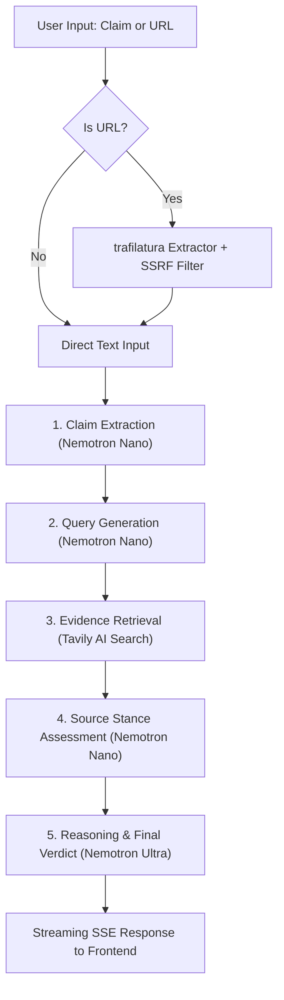

# 📡 FactCheck Radar

> **Autonomous AI Fact-Checking Agent powered by NVIDIA Nemotron via Nebius Token Factory and Tavily AI Search.**

Built for the **Nebius x NVIDIA Global AI Hackathon (Devpost) — Best Apps & Agents Track**.

[](LICENSE)
[](https://www.python.org/)
[](https://fastapi.tiangolo.com/)
[](https://react.dev/)
[](https://www.nvidia.com/)
[](https://tokenfactory.nebius.com/)
[](https://tavily.com/)
[](https://www.youtube.com/watch?v=s2DIYEr02RM)

---

## 🌐 Live Demo
Access the hosted deployment: **[<DEMO_URL>](<DEMO_URL>)**

---

## 🎯 Overview

Misinformation spreads faster than truth. **FactCheck Radar** is an autonomous multi-stage intelligence agent that takes any claim, viral headline, or news article URL, systematically deconstructs it into atomic checkable assertions, gathers authoritative cross-web evidence, evaluates conflicting viewpoints, and delivers nuanced verdicts with calibrated confidence scores and verifiable citations.

📺 **[Watch 1-Minute Live Demo Video on YouTube](https://www.youtube.com/watch?v=s2DIYEr02RM)**

### ✨ Highlights
- **NVIDIA Nemotron Synergy**: Utilizes **Nemotron Fast (`nvidia/Nemotron-3-Nano-30B-A3B`)** for high-speed claim extraction, query generation, and source stance assessment, paired with **Nemotron Reasoning (`nvidia/Nemotron-3-Ultra-550b-a55b`)** for deep synthesis, evidence weighting, and verdict generation.
- **Nebius Token Factory Native**: Directly targets Nebius Token Factory inference with dynamic `/v1/models` discovery, automatic fallback chains, and strict Pydantic JSON schema guarantees.
- **Real-Time Web Evidence (Tavily AI)**: Conducts targeted web searches, deduplicating results across authoritative domains.
- **URL Article Extractor**: Paste any article URL — FactCheck Radar automatically extracts full article content with SSRF protection before fact-checking.
- **Live SSE Streaming**: Watch the agent think in real time via Server-Sent Events, tracking progress across each pipeline stage.
- **Rich Interactive UI**: Responsive interface built with Tailwind CSS v4, dark/light mode toggle, confidence gauge, stance breakdown, evidence citation drawers, and sample claim presets.
- **Production-Ready & Hardened**: SSRF protection, path traversal defenses, in-memory LRU cache with TTL, and async non-blocking execution.

---

## 🏗️ Architecture & Pipeline



For complete technical specifications, data schemas, and resilience patterns, read [docs/architecture.md](docs/architecture.md).

## 🤖 How We Use NVIDIA Nemotron & Nebius Token Factory

FactCheck Radar pairs NVIDIA's state-of-the-art Nemotron family with Nebius Token Factory's ultra-low-latency inference infrastructure through a tiered multi-agent design:

| Pipeline Stage | Model Employed | Role & Rationale |
|---|---|---|
| **Step 1: Claim Extraction** | `nvidia/Nemotron-3-Nano-30B-A3B` | High-throughput parsing to extract atomic, verifiable assertions from messy natural language or articles. |
| **Step 2: Query Generation** | `nvidia/Nemotron-3-Nano-30B-A3B` | Fast generation of 2-4 targeted, objective search queries with minimal prompt latency. |
| **Step 4: Stance Assessment** | `nvidia/Nemotron-3-Nano-30B-A3B` | Rapid parallel classification of retrieved evidence as `SUPPORTS`, `REFUTES`, or `NEUTRAL`. |
| **Step 5: Reasoning & Verdict** | `nvidia/Nemotron-3-Ultra-550b-a55b` | Heavyweight reasoning model synthesizing contradictory evidence, balancing credibility, and calibrating final confidence. |

### Why Tiered Models?
Using a large reasoning model for every step introduces unnecessary latency and token costs. A lightweight 30B model excels at deterministic extraction and classification, executing in milliseconds. Reserving the ultra 550B model strictly for deep synthesis ensures maximum epistemic rigor where it matters most: reconciling contradictory sources and assigning calibrated confidence scores.

### Nebius Token Factory Acceleration
- **OpenAI SDK Native**: Nebius Token Factory exposes standard OpenAI-compatible endpoints (`https://api.tokenfactory.nebius.com/v1`), enabling seamless integration with zero custom transport overhead.
- **Dynamic Startup Probing**: On application boot, the backend probes `/v1/models` to discover active model deployments and configure fallback chains automatically.
- **Cost & Latency Optimization**: Enterprise-grade NVIDIA GPU hosting on Nebius delivers token generation speeds suitable for real-time interactive user experiences.

---

## ☁️ Nebius tools and services used

FactCheck Radar relies on the following Nebius AI Cloud tools and services:

1. **Nebius Token Factory (`https://api.tokenfactory.nebius.com/v1`)**:
   - Primary high-throughput inference engine serving OpenAI-compatible chat completion endpoints.
   - Dynamic `/v1/models` endpoint probing at application initialization to verify availability of NVIDIA Nemotron models (`nvidia/Nemotron-3-Nano-30B-A3B` and `nvidia/Nemotron-3-Ultra-550b-a55b`).
   - Powers the multi-stage agentic pipeline across claim decomposition, search query formulation, source stance evaluation, and high-parameter verdict reasoning.

2. **Nebius Serverless Endpoints (Deploy Target)**:
   - Primary target for containerized, on-demand cloud deployment (`nebius ai endpoint create`).
   - Runs the unified multi-stage Docker container on Nebius AMD Genoa compute (`cpu-amd-genoa`, preset `4vcpu-16gb`) with automatic SSL termination and persistent public HTTP ingress.
   - Fully documented in [docs/DEPLOY.md](docs/DEPLOY.md) alongside Render blueprint fallback.

---

## 🔍 Tavily AI Search Integration

Evidence collection in **Step 3** leverages the Tavily AI search API, purpose-built for agentic retrieval:
- **`search_depth="advanced"`**: Executes comprehensive web search retrieving contextual full-text snippets rather than just SEO headlines.
- **Source Diversity & Deduplication**: Retrieved domains are deduplicated to ensure findings are cross-verified across independent publications rather than circular references.
- **Async Non-Blocking Execution**: Tavily calls are wrapped in `asyncio.to_thread` to maintain a non-blocking FastAPI asynchronous event loop during network I/O.

---

## ⚠️ Known Limitations & Future Work

- **Paywalled & Dynamic JavaScript Sites**: URL article extraction uses `trafilatura`. Pages strictly gated behind authentication, aggressive anti-bot captchas, or pure client-side JS rendering may yield partial extracts.
- **Text-Only Scope**: Current verification operates on text claims and text articles. Multimodal verification (deepfake audio/video detection and image forensic metadata) is planned for future iterations.
- **Breaking News Latency**: For fast-breaking events occurring within minutes, authoritative fact-checking sources may not yet exist in web search indices, prompting an `UNVERIFIED` verdict with recommendations for further reporting.

---

## 🚀 Quickstart

### Prerequisites
- Python 3.11+
- Node.js 20+ & npm
- A **Nebius Token Factory API Key** ([tokenfactory.nebius.com](https://tokenfactory.nebius.com))
- A **Tavily Search API Key** ([tavily.com](https://tavily.com))

### 1. Clone & Configure
```bash
git clone https://github.com/amansheikh-techie/FactCheck_Radar.git
cd FactCheck_Radar

# Copy the example environment file
cp .env.example .env
```

Edit `.env` and insert your API keys:
```env
NEBIUS_API_KEY=your_nebius_api_key_here
TAVILY_API_KEY=your_tavily_api_key_here
NEBIUS_BASE_URL=https://api.tokenfactory.nebius.com/v1
MODEL_FAST=nvidia/Nemotron-3-Nano-30B-A3B
MODEL_REASONING=nvidia/Nemotron-3-Ultra-550b-a55b
```

---

### 2. Run Locally (Integrated Full-Stack)

#### Step A: Build Frontend
```bash
cd frontend
npm install
npm run build
cd ..
```

#### Step B: Run FastAPI Server
```bash
pip install -r backend/requirements.txt
python -m uvicorn backend.app.main:app --host 127.0.0.1 --port 8000
```
Open your browser at **`http://127.0.0.1:8000`** to access the complete application!

---

### 3. Run with Docker

Build and run the unified multi-stage container:
```bash
# Using Docker directly
docker build -t factcheck-radar .
docker run -p 8000:8000 --env-file .env factcheck-radar

# Or using Docker Compose
docker compose up --build
```
Navigate to **`http://localhost:8000`**.

---

## 🧪 Testing

FactCheck Radar comes with comprehensive automated tests and a live smoke test script.

### Run Unit Tests
```bash
python -m pytest backend/tests -v
```
*Validates Pydantic schemas, cache TTL/LRU eviction, SSRF guards, agent pipeline orchestration, and graceful unverifiable fallbacks.*

### Run Live Smoke Test (requires API keys in `.env`)
```bash
python backend/smoke_test.py
```
*Tests 3 real-world claims (True, False, Ambiguous) end-to-end against live Nebius Token Factory and Tavily APIs, printing a formatted results table.*

---

## ⚙️ Configuration Reference

| Environment Variable | Default Value | Description |
|---|---|---|
| `NEBIUS_API_KEY` | *(Required)* | API key for Nebius Token Factory |
| `NEBIUS_BASE_URL` | `https://api.tokenfactory.nebius.com/v1` | OpenAI-compatible base URL |
| `TAVILY_API_KEY` | *(Required)* | API key for Tavily AI Search |
| `MODEL_FAST` | `nvidia/Nemotron-3-Nano-30B-A3B` | High-speed model for extraction & queries |
| `MODEL_REASONING` | `nvidia/Nemotron-3-Ultra-550b-a55b` | High-parameter reasoning model for verdict generation |
| `CACHE_TTL_SECONDS` | `900` | In-memory cache duration (15 minutes) |
| `MAX_INPUT_LENGTH` | `5000` | Maximum character limit for user input |

---

## 🔒 Security & Robustness

- **SSRF Defense**: The URL extraction endpoint blocks requests to internal network ranges (`10.0.0.0/8`, `192.168.0.0/16`, `127.0.0.1`, cloud metadata `169.254.169.254`).
- **Path Traversal Protection**: Static file delivery safely resolves paths within the distribution boundary.
- **Model Fallback Chain**: If the primary Nemotron model is unavailable, the backend automatically transitions to secondary compatible models discovered during startup `/v1/models` probing.
- **Graceful Unverifiable Handling**: Queries lacking checkable factual substance (opinions, greetings, gibberish) return structured, informative feedback without wasting search quota.

---

## 📜 License

This project is licensed under the [MIT License](LICENSE).
