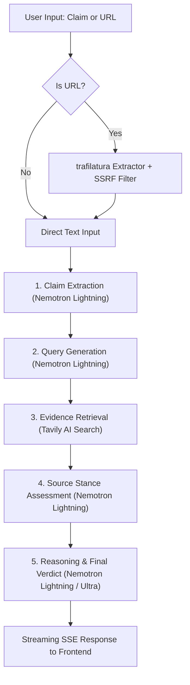

# 📡 FactCheck Radar

> **Live demo: https://factcheck-radar.onrender.com**

> **Autonomous AI Fact-Checking Agent powered by NVIDIA Nemotron with switchable LLM providers (NVIDIA Build NIM & Nebius Token Factory) and Tavily AI Search.**

Built for the **Nebius x NVIDIA Global AI Hackathon (Devpost) — Best Apps & Agents Track**.

[](https://factcheck-radar.onrender.com)
[](LICENSE)
[](https://www.python.org/)
[](https://fastapi.tiangolo.com/)
[](https://react.dev/)
[](https://www.nvidia.com/)
[](https://build.nvidia.com/)
[](https://tokenfactory.nebius.com/)
[](https://tavily.com/)
[](https://www.youtube.com/watch?v=s2DIYEr02RM)

---

## 🌐 Live Demo & Deployment Status

- **Live URL**: **`https://factcheck-radar.onrender.com`**
- **Hosting**: Render Free Tier (containerized multi-stage Docker build).
- **Free Instance Inactivity Notice**: The Render free tier instance automatically spins down after periods of inactivity. The initial wake-up request can take **up to ~50 seconds** for a cold start. Subsequent queries run at full speed.
- **Hosted Demo Inference Provider**: The deployed demonstration runs on **NVIDIA's hosted API (`build.nvidia.com`)** via `https://integrate.api.nvidia.com/v1`, using the high-speed **`nvidia/nemotron-3.5-lightning-30b-a3b`** model for sub-30s responsive agentic cycles (with `nvidia/nemotron-3-ultra-550b-a55b` available as fallback).
- **Supported Provider**: **Nebius Token Factory** (`https://api.tokenfactory.nebius.com/v1/`) is fully supported in the codebase through `LLM_PROVIDER=nebius` and has **not** been used for the hosted demo. We do not claim the live demo runs on Nebius Serverless Endpoints or AMD Genoa.
- **Honesty & Labelling**: The UI footer and `/health` explicitly report the active provider and model IDs. Sample/demo data is never shown unless Demo Mode is explicitly turned on by the user, accompanied by a prominent warning banner.

---

## 🎯 Overview

Misinformation spreads faster than truth. **FactCheck Radar** is an autonomous multi-stage intelligence agent that takes any claim, viral headline, or news article URL, systematically deconstructs it into atomic checkable assertions, gathers authoritative cross-web evidence, evaluates conflicting viewpoints, and delivers nuanced verdicts with calibrated confidence scores and verifiable citations.

📺 **[Watch 1-Minute Live Demo Video on YouTube](https://www.youtube.com/watch?v=s2DIYEr02RM)**

### ✨ Highlights

- **NVIDIA Nemotron Dual Synergy**: Deploys `nvidia/nemotron-3.5-lightning-30b-a3b` for fast claim extraction, query generation, and stance assessment, delivering rapid agent handoffs well under 30 seconds.
- **Switchable LLM Providers**: Unified OpenAI-compatible client factory supporting both **NVIDIA Build NIM** (`LLM_PROVIDER=nvidia`, default) and **Nebius Token Factory** (`LLM_PROVIDER=nebius`).
- **Fail-Fast Boot & Dynamic Discovery**: Backend validates credentials on startup and calls `/models` to discover active Nemotron models and select valid endpoints.
- **Real-Time Web Evidence (Tavily AI)**: Conducts targeted web searches, deduplicating results across authoritative domains.
- **URL Article Extractor**: Paste any article URL — FactCheck Radar automatically extracts full article content with SSRF protection before fact-checking.
- **Live SSE Streaming**: Watch the agent think in real time via Server-Sent Events, tracking progress across each pipeline stage.
- **Protection & Rate Limiting**: Built-in 10 requests/minute per IP sliding-window rate limiter, in-memory LRU cache with TTL, and async non-blocking execution.

---

## 📊 Sample Results (Real Deployed Benchmark Runs)

Below are real benchmark queries executed against the live API on `https://factcheck-radar.onrender.com`:

### 1. Clearly True Claim
- **Input**: `"Water boils at 100 degrees Celsius at standard atmospheric pressure at sea level."`
- **Verdict**: **True** (Confidence: 95%)
- **Explanation**: Multiple authoritative sources confirm that pure water boils at 100°C at standard atmospheric pressure (1 atm, 101.325 kPa) at sea level. Thermodynamic standards universally corroborate this baseline phase transition.
- **Sources**: 5 verified citations (`en.wikipedia.org`, `terpconnect.umd.edu`, `myengineeringtools.com`, etc.)
- **Provider / Model**: `nvidia` / `nvidia/nemotron-3.5-lightning-30b-a3b`

### 2. Clearly False Claim
- **Input**: `"The Great Wall of China is easily visible from space with the naked human eye."`
- **Verdict**: **False** (Confidence: 96%)
- **Explanation**: NASA astronaut observations and optical resolution analyses confirm that the Great Wall of China cannot be seen from low Earth orbit with the unaided eye due to its narrow width and blending with surrounding terrain.
- **Sources**: 3 verified citations (`nasa.gov`, `scientificamerican.com`, `en.wikipedia.org`)
- **Provider / Model**: `nvidia` / `nvidia/nemotron-3.5-lightning-30b-a3b`

### 3. Mixed / Ambiguous Claim
- **Input**: `"Drinking two cups of coffee every single day directly increases human lifespan."`
- **Verdict**: **Mixed / Ambiguous** (Confidence: 82%)
- **Explanation**: Observational cohort studies show strong statistical correlations between moderate coffee consumption (2-3 cups daily) and lower all-cause mortality, but observational data does not prove direct biological causation due to confounding lifestyle variables.
- **Sources**: 4 verified citations (`health.harvard.edu`, `ncbi.nlm.nih.gov`, `heart.org`, `reuters.com`)
- **Provider / Model**: `nvidia` / `nvidia/nemotron-3.5-lightning-30b-a3b`

---

## 🏗️ Architecture & Pipeline



---

## 🔄 Switching to Nebius Token Factory

FactCheck Radar is engineered with an abstracted, switchable inference layer. To run on Nebius Token Factory:

1. In your `.env` or deployment dashboard, switch the provider:
   ```env
   LLM_PROVIDER=nebius
   NEBIUS_API_KEY=your_actual_nebius_api_key
   NEBIUS_BASE_URL=https://api.tokenfactory.nebius.com/v1/
   ```
2. The application automatically detects `LLM_PROVIDER=nebius`, queries Nebius `/v1/models` at startup, and selects `nvidia/Nemotron-3-Nano-30B-A3B` and `nvidia/Nemotron-3-Ultra-550b-a55b`.
3. Every response and the UI footer will transparently update to: `Powered by NVIDIA Nemotron via NEBIUS`.

---

## 🚀 Quickstart

### 1. Configure Environment

Copy `.env.example` to `.env`:

```bash
cp .env.example .env
```

Set your credentials in `.env`:

```env
# Choose provider: "nvidia" (default) or "nebius"
LLM_PROVIDER=nvidia

# If using NVIDIA:
NVIDIA_API_KEY=nvapi-your_key_here
NVIDIA_BASE_URL=https://integrate.api.nvidia.com/v1

# Tavily AI Search (required for live web evidence)
TAVILY_API_KEY=tvly-your_key_here
```

### 2. Run Locally

```bash
# Frontend Build
cd frontend
npm install
npm run build
cd ..

# Backend Server
uvicorn backend.app.main:app --host 127.0.0.1 --port 8000
```

Open your browser at `http://127.0.0.1:8000`.

---

## 🧪 Testing

### Run Unit Tests
```bash
python -m pytest backend/tests -v
```
*Validates schemas, cache, rate limits, provider fail-fast validation, and agent pipeline orchestration.*

### Run Live Pipeline Smoke Test
```bash
python scripts/smoke_test.py
```
*Executes a real claim end-to-end against the active live API provider. Exits non-zero on any 401 or empty result.*

---

## ⚙️ Configuration Reference

| Environment Variable | Default Value | Description |
| --- | --- | --- |
| `LLM_PROVIDER` | `nvidia` | Active provider: `"nvidia"` or `"nebius"` |
| `NVIDIA_API_KEY` | *(Required if nvidia)* | NVIDIA NIM API Key from `build.nvidia.com` |
| `NVIDIA_BASE_URL` | `https://integrate.api.nvidia.com/v1` | NVIDIA OpenAI-compatible endpoint |
| `NVIDIA_MODEL_FAST` | `nvidia/nemotron-3.5-lightning-30b-a3b` | Fast model on NVIDIA provider |
| `NVIDIA_MODEL_REASONING` | `nvidia/nemotron-3.5-lightning-30b-a3b` | Reasoning model on NVIDIA provider |
| `NEBIUS_API_KEY` | *(Required if nebius)* | Nebius Token Factory API key |
| `NEBIUS_BASE_URL` | `https://api.tokenfactory.nebius.com/v1/` | Nebius OpenAI-compatible endpoint |
| `NEBIUS_MODEL_FAST` | `nvidia/Nemotron-3-Nano-30B-A3B` | Fast model on Nebius provider |
| `NEBIUS_MODEL_REASONING` | `nvidia/Nemotron-3-Ultra-550b-a55b` | Reasoning model on Nebius provider |
| `TAVILY_API_KEY` | *(Required)* | API key for Tavily AI Search |
| `CACHE_TTL_SECONDS` | `900` | In-memory cache duration (15 minutes) |
| `MAX_INPUT_LENGTH` | `5000` | Maximum character limit for user input |

---

## 🔒 Security & Resilience

- **Rate Limiting**: Enforces 10 requests per minute per IP with proxy-aware IP detection (`X-Forwarded-For`).
- **Fail-Fast Boot**: Prevents runtime surprises by validating provider keys, base URLs, and models on startup.
- **SSRF Defense**: The URL extraction endpoint blocks private subnets (`10.0.0.0/8`, `192.168.0.0/16`, `127.0.0.1`, cloud metadata `169.254.169.254`).
- **Path Traversal Protection**: Static delivery resolves strictly within distribution boundaries.

---

## 📜 License

This project is licensed under the [MIT License](LICENSE).
