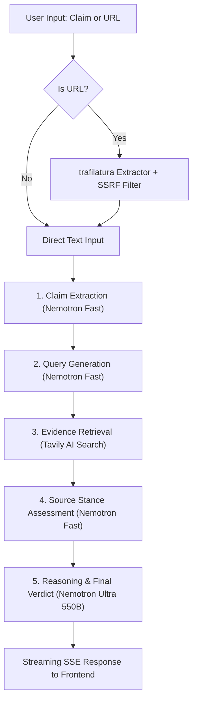

# 📡 FactCheck Radar

> **Autonomous AI Fact-Checking Agent powered by NVIDIA Nemotron with switchable providers (NVIDIA Build NIM & Nebius Token Factory) and Tavily AI Search.**

Built for the **Nebius x NVIDIA Global AI Hackathon (Devpost) — Best Apps & Agents Track**.

[](LICENSE)
[](https://www.python.org/)
[](https://fastapi.tiangolo.com/)
[](https://react.dev/)
[](https://www.nvidia.com/)
[](https://build.nvidia.com/)
[](https://tokenfactory.nebius.com/)
[](https://tavily.com/)
[](https://www.youtube.com/watch?v=s2DIYEr02RM)

---

## 🌐 Live Demo & Deployment Status

- **Live Deployed Demonstration**: Hosted on **Render** using a containerized Docker deployment.
- **Active Inference Provider for Live Demo**: Powered by the **NVIDIA NIM API** (`https://integrate.api.nvidia.com/v1`) from `build.nvidia.com` using `nvidia/nemotron-3.5-lightning-30b-a3b` and `nvidia/nemotron-3-ultra-550b-a55b`.
- **Supported Provider**: **Nebius Token Factory** (`https://api.tokenfactory.nebius.com/v1/`) is fully supported and switchable on-demand via `LLM_PROVIDER=nebius`.
- **Transparency & Honesty Guarantee**: Every API response returns the exact `provider` and `models_used`. Sample data never silently appears; demonstration data only appears when the user explicitly enables Demo Mode, marked with clear notice banners.

---

## 🎯 Overview

Misinformation spreads faster than truth. **FactCheck Radar** is an autonomous multi-stage intelligence agent that takes any claim, viral headline, or news article URL, systematically deconstructs it into atomic checkable assertions, gathers authoritative cross-web evidence, evaluates conflicting viewpoints, and delivers nuanced verdicts with calibrated confidence scores and verifiable citations.

📺 **[Watch 1-Minute Live Demo Video on YouTube](https://www.youtube.com/watch?v=s2DIYEr02RM)**

### ✨ Highlights

- **NVIDIA Nemotron Synergy**: Utilizes **Nemotron Fast (`nvidia/nemotron-3.5-lightning-30b-a3b` or `nvidia/Nemotron-3-Nano-30B-A3B`)** for high-speed claim extraction, query generation, and source stance assessment, paired with **Nemotron Reasoning (`nvidia/nemotron-3-ultra-550b-a55b`)** for deep synthesis, evidence weighting, and verdict generation.
- **Switchable LLM Providers**: Unified OpenAI-compatible client factory supporting both **NVIDIA Build NIM** (`LLM_PROVIDER=nvidia`, default) and **Nebius Token Factory** (`LLM_PROVIDER=nebius`).
- **Dynamic Startup Discovery & Fail-Fast Validation**: At boot, the backend validates credentials and calls `/models` for the active provider, discovering Nemotron models and selecting the closest matching valid endpoints.
- **Real-Time Web Evidence (Tavily AI)**: Conducts targeted web searches, deduplicating results across authoritative domains.
- **URL Article Extractor**: Paste any article URL — FactCheck Radar automatically extracts full article content with SSRF protection before fact-checking.
- **Live SSE Streaming**: Watch the agent think in real time via Server-Sent Events, tracking progress across each pipeline stage.
- **Protection & Rate Limiting**: Built-in 10 requests/minute per IP rate limiter, in-memory LRU cache with TTL, and async non-blocking execution to safeguard quotas.

---

## 🏗️ Architecture & Pipeline



---

## 🤖 Dual-Tiered Model Specialization

FactCheck Radar pairs NVIDIA's Nemotron family through a tiered multi-agent design:

| Pipeline Stage | Active NVIDIA Model | Active Nebius Model | Role & Rationale |
| --- | --- | --- | --- |
| **Step 1: Claim Extraction** | `nvidia/nemotron-3.5-lightning-30b-a3b` | `nvidia/Nemotron-3-Nano-30B-A3B` | High-throughput parsing to extract atomic, verifiable assertions from messy text. |
| **Step 2: Query Generation** | `nvidia/nemotron-3.5-lightning-30b-a3b` | `nvidia/Nemotron-3-Nano-30B-A3B` | Fast generation of objective search queries with minimal prompt latency. |
| **Step 4: Stance Assessment** | `nvidia/nemotron-3.5-lightning-30b-a3b` | `nvidia/Nemotron-3-Nano-30B-A3B` | Rapid parallel classification of retrieved evidence as `SUPPORTS`, `CONTRADICTS`, or `NEUTRAL`. |
| **Step 5: Reasoning & Verdict** | `nvidia/nemotron-3-ultra-550b-a55b` | `nvidia/Nemotron-3-Ultra-550b-a55b` | 550B frontier model synthesizing evidence, balancing credibility, and calibrating confidence. |

---

## ☁️ Supported Inference Providers

1. **NVIDIA Build NIM (`https://integrate.api.nvidia.com/v1`)**:
   - Hosted API from `build.nvidia.com` powering the live demonstration.
   - Serves high-throughput Nemotron models with low latency.

2. **Nebius Token Factory (`https://api.tokenfactory.nebius.com/v1/`)**:
   - Supported OpenAI-compatible inference engine on Nebius AI Cloud.
   - Dynamic `/v1/models` probing at startup to verify and resolve active Nemotron endpoints.

---

## 🚀 Quickstart

### 1. Configure Environment

Copy `.env.example` to `.env`:

```bash
cp .env.example .env
```

Set your credentials in `.env`:

```env
# Choose provider: "nvidia" (default) or "nebius"
LLM_PROVIDER=nvidia

# If using NVIDIA:
NVIDIA_API_KEY=nvapi-your_key_here
NVIDIA_BASE_URL=https://integrate.api.nvidia.com/v1

# If using Nebius Token Factory:
# NEBIUS_API_KEY=your_nebius_key_here
# NEBIUS_BASE_URL=https://api.tokenfactory.nebius.com/v1/

# Tavily AI Search (required for live web evidence)
TAVILY_API_KEY=tvly-your_key_here
```

### 2. Run Locally

```bash
# Frontend Build
cd frontend
npm install
npm run build
cd ..

# Backend Server
uvicorn backend.app.main:app --host 127.0.0.1 --port 8000
```

Open your browser at `http://127.0.0.1:8000`.

---

## 🧪 Testing

### Run Unit Tests
```bash
python -m pytest backend/tests -v
```
*Validates schemas, cache, rate limits, provider fail-fast validation, and agent pipeline orchestration.*

### Run Live Pipeline Smoke Test
```bash
python scripts/smoke_test.py
```
*Executes a real claim end-to-end against the active live API provider (claim extraction -> Tavily search -> source assessment -> Nemotron Ultra 550B verdict). Exits non-zero on any 401 or empty result.*

---

## ⚙️ Configuration Reference

| Environment Variable | Default Value | Description |
| --- | --- | --- |
| `LLM_PROVIDER` | `nvidia` | Active provider: `"nvidia"` or `"nebius"` |
| `NVIDIA_API_KEY` | *(Required if nvidia)* | NVIDIA NIM API Key from `build.nvidia.com` |
| `NVIDIA_BASE_URL` | `https://integrate.api.nvidia.com/v1` | NVIDIA OpenAI-compatible endpoint |
| `NEBIUS_API_KEY` | *(Required if nebius)* | Nebius Token Factory API key |
| `NEBIUS_BASE_URL` | `https://api.tokenfactory.nebius.com/v1/` | Nebius OpenAI-compatible endpoint |
| `TAVILY_API_KEY` | *(Required)* | API key for Tavily AI Search |
| `NVIDIA_MODEL_FAST` | `nvidia/nemotron-3.5-lightning-30b-a3b` | Fast model on NVIDIA provider |
| `NVIDIA_MODEL_REASONING` | `nvidia/nemotron-3-ultra-550b-a55b` | Reasoning model on NVIDIA provider |
| `NEBIUS_MODEL_FAST` | `nvidia/Nemotron-3-Nano-30B-A3B` | Fast model on Nebius provider |
| `NEBIUS_MODEL_REASONING` | `nvidia/Nemotron-3-Ultra-550b-a55b` | Reasoning model on Nebius provider |
| `CACHE_TTL_SECONDS` | `900` | In-memory cache duration (15 minutes) |
| `MAX_INPUT_LENGTH` | `5000` | Maximum character limit for user input |

---

## 🔒 Security & Resilience

- **Rate Limiting**: Enforces 10 requests per minute per IP with proxy-aware IP detection (`X-Forwarded-For`).
- **Fail-Fast Boot**: Prevents runtime surprises by validating provider keys, base URLs, and models on startup.
- **SSRF Defense**: The URL extraction endpoint blocks private subnets (`10.0.0.0/8`, `192.168.0.0/16`, `127.0.0.1`, cloud metadata `169.254.169.254`).
- **Path Traversal Protection**: Static delivery resolves strictly within distribution boundaries.

---

## 📜 License

This project is licensed under the [MIT License](LICENSE).
