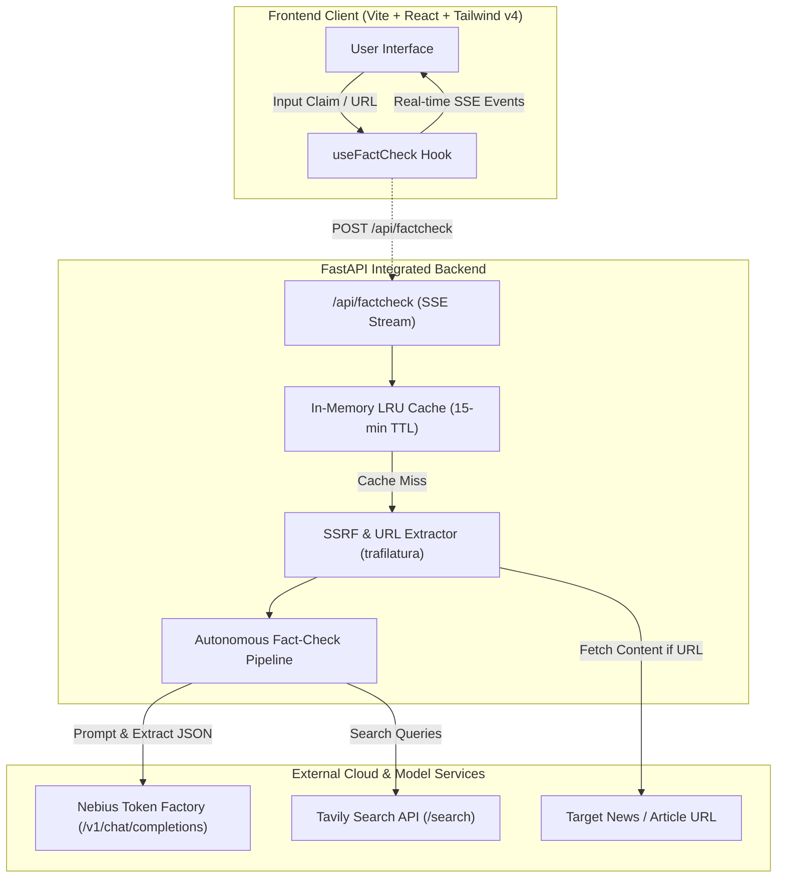
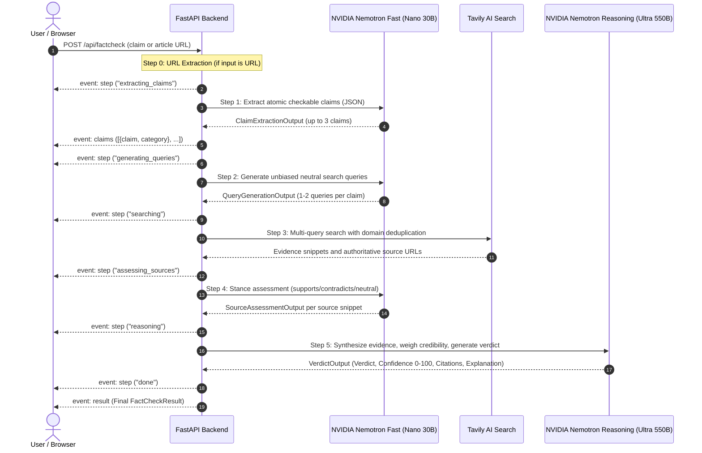

# FactCheck Radar — System Architecture

FactCheck Radar is an autonomous multi-stage AI agent designed for the **Nebius x NVIDIA Global AI Hackathon (Best Apps & Agents track)**. It leverages **NVIDIA Nemotron models via the Nebius Token Factory inference API** and **Tavily AI Search** to ingest arbitrary claims, articles, or news URLs and produce nuanced, evidence-backed verifications in real-time.

---

## 1. High-Level System Architecture



---

## 2. Autonomous Multi-Agent Pipeline

The fact-checking pipeline executes 5 sequential stages, streaming status indicators and structured intermediate artifacts over Server-Sent Events (SSE).



---

## 3. NVIDIA Nemotron Model Routing & Resilience

Nebius Token Factory hosts high-throughput OpenAI-compatible endpoints for NVIDIA Nemotron models. FactCheck Radar splits workload between high-speed extraction and deep reasoning:

| Role | Primary Model | Fallback Models | Purpose |
|---|---|---|---|
| **Fast Agent** | `nvidia/Nemotron-3-Nano-30B-A3B` | `nvidia/nemotron-3-super-120b-a12b`, `nvidia/nemotron-mini-4b-instruct` | Atomic claim extraction, neutral search query generation, per-source stance evaluation |
| **Reasoning Agent** | `nvidia/Nemotron-3-Ultra-550b-a55b` | `nvidia/nemotron-3-super-120b-a12b` | Cross-source synthesis, conflicting evidence reconciliation, confidence calibration, cited explanations |

### Startup Model Discovery
On application startup, the FastAPI lifespan event executes `GET /v1/models` against the configured Nebius base URL. It confirms model presence, automatically falls back to secondary supported models if a specific cluster is under maintenance, and outputs an operational diagnostic.

### JSON Schema Enforcement & Markdown Fence Stripping
- Every prompt requests structured output with strict Pydantic schemas.
- If raw output contains markdown wrapping (e.g. ` ```json ... ``` `), `_clean_json_str()` strips it cleanly before parsing.
- If schema validation fails, the client initiates an in-band corrective retry (`_chat_json_inner`) containing the exact ValidationError so Nemotron can self-correct.

---

## 4. Evidence Retrieval & Deduplication

1. **Search Depth**: Tavily API is queried with `search_depth="advanced"`.
2. **Domain Diversity**: Multiple queries per claim are merged, and results are deduplicated by domain to prevent a single domain from monopolizing the evidence pool.
3. **Async Non-Blocking Execution**: Both OpenAI and Tavily synchronous SDK network calls are wrapped with `asyncio.to_thread` to ensure the ASGI event loop remains unblocked and responsive under concurrent user traffic.

---

## 5. Security Architecture

1. **Server-Side Request Forgery (SSRF) Guard**:
   - `is_safe_url()` inspects all URL inputs before fetching.
   - Blocks loopback (`127.0.0.1`, `localhost`), link-local metadata services (`169.254.169.254`), and private IPv4/IPv6 networks (`10.0.0.0/8`, `172.16.0.0/12`, `192.168.0.0/16`).
2. **Directory Traversal Protection**:
   - In production static file serving, paths are evaluated against the resolved frontend distribution root using Python 3.9+ `Path.is_relative_to()`.
3. **API Key Isolation**:
   - Frontend components never receive or store Nebius or Tavily API keys; all third-party interactions occur securely backend-side.
4. **Input Boundary Enforcement**:
   - Inputs are capped at 5,000 characters with character counters, and extracted article contents are bounded at 3,000 characters to prevent prompt injection and token overflow.
